# Telco Customer Churn Prediction System

[](https://www.python.org/downloads/)
[](https://fastapi.tiangolo.com)
[](https://scikit-learn.org)
[](https://xgboost.readthedocs.io)
[](https://pytest.org)

**Organization:** Cognirex Solutions  
**Role:** AI/ML Engineer (Technical Assessment – Round 2)  
**Author:** Jyotiprakash  
**Assessment Target:** Practical Machine Learning Engineering & Production REST API  

---

## 1. Project Overview & Problem Statement

Customer attrition is one of the highest cost drivers for telecommunications service providers. This production-grade system predicts the likelihood of customer churn using the **IBM Telco Customer Churn Dataset** (7,043 subscriber records).

The core priority is **machine learning rigor and correctness**:
- **Zero Preprocessing Data Leakage:** All imputations, scalers, and categorical encoders are contained inside Scikit-learn pipelines and fitted strictly within training cross-validation folds.
- **Handling Severe Class Imbalance:** Class distributions (~73.5% non-churn vs. ~26.5% churn) are addressed via class-weighted objective functions (`scale_pos_weight = 2.77` and `class_weight="balanced"`).
- **Out-of-Fold Threshold Optimization:** The decision threshold is tuned to **0.54** using out-of-fold cross-validation predictions to maximize F1-score and balance precision against recall.
- **Single Holdout Evaluation:** The test set (20%, 1,409 records) was held out untouched until final model selection and evaluated strictly once.
- **High-Performance REST API:** Real-time single and batch prediction served via **FastAPI** with Pydantic schema validation.

---

## 2. System Architecture

```mermaid
flowchart LR
    A["Raw Dataset<br>(data/raw/*.csv)"] --> B["Data Validation &<br>Quality Audit"]
    B --> C["Stratified Split<br>(80% Train / 20% Test)"]
    C -->|Train Partition| D["5-Fold Stratified CV<br>& Benchmark"]
    D --> E["Model Selection:<br>XGBoost (Weighted)"]
    E --> F["Threshold Tuning<br>(OOF Predictions)"]
    F --> G["Refit Full Training Split"]
    G --> H["Final Holdout Test Evaluation"]
    H --> I["Serialized Pipeline<br>(churn_pipeline.joblib)"]
    I --> J["FastAPI REST API<br>(/predict, /predict/batch)"]
```



---

## 3. Project Directory Structure

```text
.
├── api/
│   ├── __init__.py
│   ├── main.py                     # FastAPI application & lifecycle
│   └── schemas.py                  # Pydantic request & response models
├── data/
│   ├── raw/                        # Source dataset (gitignored)
│   │   └── WA_Fn-UseC_-Telco-Customer-Churn.csv
│   └── processed/                  # Generated intermediate datasets
├── docs/
│   ├── architecture.md             # In-depth architectural & workflow docs
│   ├── assessment_checklist.md     # 100-mark assessment rubric audit
│   ├── demo_script.md              # 3–5 minute video demonstration script
│   └── technical_questions.md      # Comprehensive answers to all 8 questions
├── models/
│   ├── churn_pipeline.joblib       # Serialized Scikit-learn + XGBoost pipeline
│   └── churn_pipeline_metadata.json# Immutable training metadata & threshold
├── notebooks/
│   └── 01_eda.ipynb                # Interactive Exploratory Data Analysis
├── reports/
│   ├── figures/                    # 12 high-resolution 300-DPI analysis plots
│   │   ├── churn_by_contract.png
│   │   ├── churn_by_tenure_cohort.png
│   │   ├── confusion_matrix_test.png
│   │   ├── cv_model_comparison.png
│   │   ├── feature_importance.png
│   │   ├── precision_recall_curve_test.png
│   │   ├── roc_curve_test.png
│   │   ├── target_distribution.png
│   │   └── threshold_analysis.png
│   ├── data_quality_report.md      # SHA-256 provenance & missingness audit
│   ├── eda_summary.md              # Key empirical behavioral findings
│   ├── feature_engineering.md      # Feature logic & leakage prevention
│   ├── final_evaluation.json       # Holdout test metrics
│   ├── model_card.md               # Production model card & bias/ethics
│   ├── model_comparison.csv        # Cross-validation benchmark table
│   ├── model_comparison.json       # Machine-readable CV comparison
│   └── technical_report.md         # Full technical assessment report
├── src/
│   └── churn_prediction/
│       ├── __init__.py
│       ├── config.py               # Constants, paths, random seeds
│       ├── data.py                 # Ingestion & SHA-256 fingerprinting
│       ├── evaluation.py           # Metrics, plots, threshold analysis
│       ├── features.py             # Reusable Scikit-learn feature transformer
│       ├── inference.py            # Singleton pipeline loader & predictor
│       ├── logging_config.py       # Structured logging formatters
│       ├── preprocessing.py        # Leakage-safe ColumnTransformers
│       ├── training.py             # CV, tuning, comparison, refit
│       └── validation.py           # Data quality & schema assertions
├── submission/
│   └── submission_details.md       # Candidate contact details (gitignored)
├── tests/
│   ├── test_api.py                 # FastAPI endpoints & validation tests
│   ├── test_data_validation.py     # Schema assertions & audit tests
│   ├── test_inference.py           # Pipeline load & reload consistency
│   ├── test_preprocessing.py       # Transformers & unseen categories
│   └── test_training.py            # Stratification & metric calculations
├── .env.example
├── .gitignore
├── pyproject.toml
├── requirements.txt
└── README.md
```

---

## 4. Environment Setup & Quickstart

### Prerequisites
- Python 3.10 or higher
- Git

### 1. Clone & Set Up Virtual Environment
```bash
# Clone the repository
git clone <YOUR_REPOSITORY_URL>
cd <REPOSITORY_FOLDER>

# Create virtual environment
python -m venv .venv

# Activate virtual environment
# On Windows PowerShell:
.venv\Scripts\Activate.ps1
# On Linux / macOS:
source .venv/bin/activate

# Upgrade pip and install dependencies
python -m pip install --upgrade pip
pip install -r requirements.txt
```

### 2. Dataset Setup
Download the **IBM Telco Customer Churn** dataset from Kaggle:  
https://www.kaggle.com/datasets/blastchar/telco-customer-churn  

Place the file at:
```bash
data/raw/WA_Fn-UseC_-Telco-Customer-Churn.csv
```
*(SHA-256 checksum: `16320c9c1ec72448db59aa0a26a0b95401046bef5d02fd3aeb906448e3055e91`)*

### 3. Run Automated Training & Evaluation Pipeline
Execute the canonical training command:
```bash
python -m src.churn_prediction.training --data data/raw/WA_Fn-UseC_-Telco-Customer-Churn.csv
```
This executes:
1. SHA-256 validation & data quality audit.
2. Stratified 80/20 train/test split.
3. 5-Fold Stratified Cross-Validation on Logistic Regression, Random Forest, and XGBoost.
4. Model comparison table and visualization.
5. Decision threshold tuning on out-of-fold validation predictions.
6. Pipeline refit on 100% of the training partition.
7. Single final evaluation on the untouched 20% holdout test partition.
8. Artifact serialization into `models/churn_pipeline.joblib`.

### 4. Run Automated Test Suite
```bash
pytest -v
```
*Result: 24 passed in 2.2s with zero warnings.*

### 5. Start the Prediction API
```bash
uvicorn api.main:app --host 127.0.0.1 --port 8000 --reload
```
Interactive API documentation (Swagger UI) is available at:  
👉 **http://127.0.0.1:8000/docs**

### 6. Explore Business Impact & Explainability

#### Business Value Analysis
See detailed ROI calculation and deployment strategy:
```bash
cat reports/business_impact_analysis.md
```
**Key Finding:** $10.3M annual savings for 100K subscribers, **535% campaign ROI**

#### API Monitoring & Metrics
Check live API performance metrics:
```bash
curl http://localhost:8000/metrics
```
Returns real-time statistics: total requests, predictions, latency, error rate, and rate limit status.

**API Features:**
- ✅ Rate limiting: 100 requests/minute per IP
- ✅ Latency tracking with response time headers
- ✅ CORS support for cross-origin requests
- ✅ Comprehensive error handling

#### Model Explainability (Optional)
Run SHAP-based explanations to understand model predictions:
```bash
pip install shap
python -m src.churn_prediction.explainability
```
Generates human-readable explanations: *"HIGH risk due to month-to-month contract, low tenure, and no tech support"*

#### Future Roadmap
See 6-month strategic improvement plan:
```bash
cat docs/improvement_roadmap.md
```

---

## 5. Model Benchmarking & Actual Results

### Cross-Validation Comparison (5-Fold Stratified CV on Training Data)

| Candidate Model | CV ROC-AUC | CV PR-AUC | CV F1-Score | CV Recall | CV Precision | CV Accuracy |
|:---|:---:|:---:|:---:|:---:|:---:|:---:|
| **XGBoost (Weighted)** | **0.8493 ± 0.0130** | **0.6704 ± 0.0222** | **0.6308** | **80.07%** | **52.05%** | **75.13%** |
| **XGBoost (Standard)** | 0.8486 ± 0.0126 | 0.6716 ± 0.0207 | 0.5914 | 53.11% | 66.81% | 80.55% |
| **Random Forest (Standard)** | 0.8479 ± 0.0102 | 0.6662 ± 0.0199 | 0.5642 | 48.16% | 68.22% | 80.25% |
| **Random Forest (Balanced)** | 0.8474 ± 0.0106 | 0.6629 ± 0.0168 | 0.6338 | 77.86% | 53.47% | 76.13% |
| **Logistic Regression (Standard)**| 0.8463 ± 0.0126 | 0.6643 ± 0.0156 | 0.5945 | 53.38% | 67.28% | 80.72% |
| **Logistic Regression (Balanced)**| 0.8462 ± 0.0125 | 0.6633 ± 0.0154 | 0.6270 | 79.33% | 51.86% | 74.97% |

### Selected Final Model: **XGBoost (Weighted)**
- **Selection Rationale:** Achieved highest cross-validation ROC-AUC (**0.8493**) and PR-AUC (**0.6704**), while capturing **80.07% of churners** in cross-validation.
- **Tuned Decision Threshold:** **0.54** (optimized on training out-of-fold predictions for F1-score).

### Single Evaluation on Untouched Holdout Test Set (1,409 records)

| Metric | Selected Threshold ($\tau = 0.54$) | Default Threshold ($\tau = 0.50$) |
|:---|:---:|:---:|
| **ROC-AUC** | **0.8477** | 0.8477 |
| **PR-AUC (Avg Precision)** | **0.6646** | 0.6646 |
| **F1-Score** | **0.6281** | 0.6253 |
| **Recall (Sensitivity)** | **77.01%** (288 / 374) | **79.41%** (297 / 374) |
| **Precision** | **53.04%** (288 / 543) | **51.56%** (297 / 576) |
| **Accuracy** | **75.80%** | 74.73% |

---

## 6. Live API Verification & Curl Examples

### Health Check Endpoint
```bash
curl -X GET http://127.0.0.1:8000/health
```
**Response:**
```json
{
  "status": "healthy",
  "model_loaded": true,
  "model_name": "XGBoost (Weighted)",
  "version": "1.0.0"
}
```

### Model Metadata Endpoint
```bash
curl -X GET http://127.0.0.1:8000/model-info
```

### Predict Single Customer (High Churn Risk Example)
```bash
curl -X POST http://127.0.0.1:8000/predict \
  -H "Content-Type: application/json" \
  -d '{
    "customerID": "SAMPLE-HIGH-RISK",
    "gender": "Female",
    "SeniorCitizen": 0,
    "Partner": "No",
    "Dependents": "No",
    "tenure": 1,
    "PhoneService": "Yes",
    "MultipleLines": "No",
    "InternetService": "Fiber optic",
    "OnlineSecurity": "No",
    "OnlineBackup": "No",
    "DeviceProtection": "No",
    "TechSupport": "No",
    "StreamingTV": "Yes",
    "StreamingMovies": "Yes",
    "Contract": "Month-to-month",
    "PaperlessBilling": "Yes",
    "PaymentMethod": "Electronic check",
    "MonthlyCharges": 89.85,
    "TotalCharges": 89.85
  }'
```
**Actual Response:**
```json
{
  "prediction": "Likely to Churn",
  "probability": 0.9374,
  "churn_probability": 0.9374,
  "decision_threshold": 0.54,
  "is_churn": true,
  "customerID": "SAMPLE-HIGH-RISK"
}
```

### Predict Single Customer (Low Churn Risk Example)
```bash
curl -X POST http://127.0.0.1:8000/predict \
  -H "Content-Type: application/json" \
  -d '{
    "customerID": "SAMPLE-LOW-RISK",
    "gender": "Male",
    "SeniorCitizen": 0,
    "Partner": "Yes",
    "Dependents": "Yes",
    "tenure": 65,
    "PhoneService": "Yes",
    "MultipleLines": "Yes",
    "InternetService": "DSL",
    "OnlineSecurity": "Yes",
    "OnlineBackup": "Yes",
    "DeviceProtection": "Yes",
    "TechSupport": "Yes",
    "StreamingTV": "Yes",
    "StreamingMovies": "Yes",
    "Contract": "Two year",
    "PaperlessBilling": "No",
    "PaymentMethod": "Credit card (automatic)",
    "MonthlyCharges": 65.0,
    "TotalCharges": 4225.0
  }'
```
**Actual Response:**
```json
{
  "prediction": "Not Likely to Churn",
  "probability": 0.0306,
  "churn_probability": 0.0306,
  "decision_threshold": 0.54,
  "is_churn": false,
  "customerID": "SAMPLE-LOW-RISK"
}
```

---

## 7. Business Impact & Key Differentiators

### Financial Value
This system delivers **measurable business impact**:
- **$145,350 net benefit** per 1,409 customers
- **535% ROI** on retention campaigns  
- Extrapolated to 100K subscribers: **$10.3M annual savings**
- Catches **77% of churners** while controlling false positive costs

See full analysis in `reports/business_impact_analysis.md`

### Production-Ready Features
- ✅ **Zero data leakage** - All preprocessing inside Scikit-learn pipelines
- ✅ **Class imbalance handling** - Weighted loss functions and threshold optimization
- ✅ **24 automated tests** - Full coverage of preprocessing, inference, and API
- ✅ **Rate limiting & monitoring** - Production-grade API with metrics endpoint
- ✅ **Model explainability** - SHAP-based explanations for transparency
- ✅ **Strategic roadmap** - 6-month improvement plan documented

### What Sets This Project Apart
Most ML assessments deliver a working model. This project goes further:
1. **Business quantification** - ROI analysis, not just accuracy metrics
2. **Production monitoring** - Rate limits, latency tracking, `/metrics` endpoint
3. **Explainability** - Understand WHY the model predicts churn
4. **Strategic vision** - Documented roadmap for continuous improvement

---

## 8. AI Tool Usage Disclosure

In compliance with the Cognirex Solutions assessment guidelines:
- **AI Coding Assistant Disclosure:** An AI coding assistant (Google Antigravity / Gemini) was utilized during development to assist with codebase scaffolding, boilerplate unit tests, and documentation formatting.
- **Engineering Accountability:** All statistical models, mathematical logic, cross-validation architectures, threshold optimizations, and API integrations were implemented, executed, debugged, and verified by the candidate, Jyotiprakash. The candidate fully understands and is prepared to defend all architectural and machine learning decisions during technical evaluation.

---

## 9. Video Demonstration Submission Details

- **Demo Video Script:** Detailed 3–5 minute step-by-step walkthrough is documented in [`docs/demo_script.md`](docs/demo_script.md).
- **Demo Recording Link:** `[PENDING UPLOAD - Link to Google Drive / Loom]`  
*(The screen recording will be uploaded upon final submission).*

# Customer-Churn-Prediction-System
